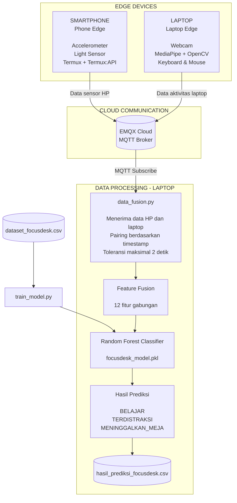

# FocusDesk AI
### Sistem Pemantauan Pola Aktivitas Fisik Saat Belajar Berbasis IoT dan Artificial Intelligence

## 1. Tentang FocusDesk AI

FocusDesk AI adalah sistem berbasis Internet of Things (IoT) dan Artificial Intelligence (AI) yang dirancang untuk memantau pola aktivitas fisik seseorang selama sesi belajar.

Sistem menggunakan sensor smartphone dan laptop untuk mengumpulkan data aktivitas. Data dikirim melalui MQTT, digabungkan berdasarkan timestamp, kemudian dianalisis menggunakan model Machine Learning **Random Forest Classifier**.

Sistem mengklasifikasikan aktivitas pengguna menjadi tiga kategori:

- `belajar`
- `terdistraksi`
- `meninggalkan_meja`

**Catatan:** Sistem mengklasifikasikan pola aktivitas fisik berdasarkan data sensor, bukan mengukur kondisi mental atau tingkat konsentrasi secara langsung.

---

## 2. Arsitektur Sistem

FocusDesk AI terdiri dari tiga bagian utama, yaitu Phone Edge, Laptop Edge, serta Cloud dan Data Fusion.

### Diagram Arsitektur



### A. Phone Edge (Smartphone)

Menggunakan Android dengan Termux dan Termux:API.

Sensor yang digunakan:
- **Accelerometer:** mendeteksi perubahan gerakan smartphone.
- **Light Sensor:** mengukur intensitas cahaya di sekitar perangkat.

Data sensor dikirim ke MQTT Broker.

### B. Laptop Edge

Menggunakan webcam dan perangkat input laptop.

Komponen yang digunakan:
- **Webcam:** mengambil gambar untuk mendeteksi keberadaan wajah.
- **MediaPipe:** membantu mendeteksi wajah dan memperkirakan posisi kepala.
- **OpenCV:** memproses citra dan memperkirakan orientasi kepala.
- **Keyboard dan Mouse:** mendeteksi aktivitas interaksi pengguna.

Data aktivitas laptop dikirim ke MQTT Broker.

### C. Cloud dan Data Fusion

Menggunakan **EMQX Cloud** sebagai MQTT Broker.

Program `data_fusion.py` menerima data dari smartphone dan laptop, menggabungkannya berdasarkan timestamp dengan toleransi maksimal dua detik, kemudian meneruskan data gabungan ke model Machine Learning untuk menghasilkan prediksi.

Model Random Forest sebelumnya dilatih menggunakan dataset melalui program `train_model.py` dan disimpan dalam file `focusdesk_model.pkl`.

---

## 3. Teknologi yang Digunakan

| Komponen | Teknologi |
|---|---|
| Bahasa pemrograman | Python |
| Smartphone Edge | Termux, Termux:API |
| Sensor smartphone | Accelerometer, Light Sensor |
| Computer Vision | OpenCV, MediaPipe |
| Input laptop | pynput |
| Komunikasi IoT | MQTT |
| MQTT Broker | EMQX Cloud |
| Machine Learning | Scikit-learn |
| Algoritma AI | Random Forest |
| Pengolahan data | Pandas, NumPy |
| Penyimpanan model | Joblib |

---

# 4. Panduan Instalasi

Ikuti langkah-langkah berikut untuk mempersiapkan FocusDesk AI.

## Langkah 1 — Persiapan Perangkat

Siapkan perangkat berikut:

1. Laptop atau komputer Windows.
2. Smartphone Android.
3. Koneksi internet pada kedua perangkat.
4. Python yang sudah terinstal pada laptop.
5. Termux dan Termux:API pada smartphone.
6. Akun dan konfigurasi MQTT EMQX Cloud.

Pastikan laptop dan smartphone dapat terhubung ke internet.

## Langkah 2 — Clone Repository

Buka terminal atau VS Code, kemudian jalankan:

```bash
git clone https://github.com/rezaalf06/FocusDesk.git
```

Masuk ke folder proyek:

```bash
cd FocusDesk
```

## Langkah 3 — Membuat Virtual Environment

Pada laptop, buat virtual environment:

```bash
python -m venv .venv
```

Aktifkan virtual environment pada Windows:

```bash
.venv\Scripts\activate
```

Jika berhasil, nama `.venv` akan muncul pada bagian awal terminal.

## Langkah 4 — Instalasi Dependencies

Pastikan virtual environment sudah aktif, kemudian jalankan:

```bash
pip install -r requirements.txt
```

Tunggu hingga seluruh library selesai diinstal.

## Langkah 5 — Konfigurasi MQTT

Sistem menggunakan EMQX Cloud sebagai perantara komunikasi antara smartphone dan laptop.

Salin file konfigurasi template:

```bash
copy config_private.example.py config_private.py
```

Buka file `config_private.py`, kemudian masukkan kredensial MQTT EMQX Cloud yang digunakan:

```python
BROKER = "YOUR_EMQX_HOSTNAME"
PORT = 8883
USERNAME = "YOUR_MQTT_USERNAME"
PASSWORD = "YOUR_MQTT_PASSWORD"
```

Ganti nilai tersebut dengan konfigurasi MQTT masing-masing.

**Penting:**
- Jangan mengunggah `config_private.py` ke GitHub.
- Jangan membagikan username dan password MQTT kepada pihak yang tidak berkepentingan.
- File `config_private.example.py` hanya merupakan template konfigurasi.

## Langkah 6 — Persiapan Smartphone

Pada smartphone Android:

1. Instal Termux.
2. Instal Termux:API.
3. Berikan izin akses sensor yang diperlukan.
4. Pastikan smartphone terhubung ke internet.
5. Siapkan file `hp_sensor_MQTT.py` dan `config_private.py` pada lingkungan Termux.
6. Pastikan konfigurasi MQTT pada smartphone sama dengan konfigurasi yang digunakan laptop.

Program smartphone dijalankan melalui Termux.

---

# 5. Panduan Menjalankan Sistem

Setelah seluruh persiapan selesai, jalankan ketiga bagian sistem berikut.

**Urutan menjalankan program:**

### A. Terminal 1 — Data Fusion

Pada laptop, aktifkan virtual environment dan jalankan:

```bash
python data_fusion.py
```

Program ini berfungsi untuk:
- Terhubung ke MQTT Broker.
- Menerima data dari smartphone dan laptop.
- Menggabungkan data berdasarkan timestamp.
- Mengolah data menggunakan model Random Forest.
- Menghasilkan prediksi aktivitas.
- Menyimpan hasil prediksi ke file CSV.

Biarkan terminal tetap berjalan.

### B. Terminal 2 — Laptop Edge

Buka terminal baru pada folder proyek, aktifkan virtual environment, kemudian jalankan:

```bash
python laptop_edge.py
```

Program akan:
- Mengaktifkan webcam.
- Mendeteksi keberadaan wajah.
- Memperkirakan orientasi kepala.
- Memantau aktivitas keyboard dan mouse.
- Mengirimkan data ke MQTT Broker.

Pastikan webcam dapat digunakan oleh program.

### C. Smartphone — Phone Edge

Buka Termux pada smartphone, kemudian jalankan:

```bash
python hp_sensor_MQTT.py
```

Program akan:
- Membaca data accelerometer.
- Membaca data light sensor.
- Mengolah data sensor.
- Mengirimkan data ke MQTT Broker.

Pastikan aplikasi Termux tetap berjalan selama proses pengujian.

**Catatan:** Ketiga program harus berjalan bersamaan agar proses penggabungan data dan prediksi dapat berlangsung.

---

# 6. Melihat Hasil Prediksi

Jika seluruh perangkat berhasil terhubung dan data diterima, program `data_fusion.py` akan menampilkan hasil klasifikasi aktivitas.

Kategori hasil prediksi:

| Kategori | Keterangan |
|---|---|
| BELAJAR | Pola aktivitas yang dikategorikan sebagai belajar |
| TERDISTRAKSI | Pola aktivitas yang dikategorikan sebagai terdistraksi |
| MENINGGALKAN_MEJA | Pola aktivitas yang dikategorikan sebagai meninggalkan meja |

Hasil prediksi juga disimpan secara otomatis dalam file:

```text
hasil_prediksi_focusdesk.csv
```

File tersebut berisi data hasil pemrosesan dan klasifikasi aktivitas selama sistem berjalan.

---

# 7. Struktur File Proyek

Berikut fungsi masing-masing file utama:

| File | Fungsi |
|---|---|
| `hp_sensor_MQTT.py` | Membaca sensor smartphone dan mengirim data melalui MQTT |
| `laptop_edge.py` | Mengumpulkan data webcam, orientasi kepala, keyboard, dan mouse |
| `data_fusion.py` | Menerima, menggabungkan, dan memprediksi data dari kedua perangkat |
| `train_model.py` | Melatih model Machine Learning |
| `focusdesk_model.pkl` | Model Random Forest yang telah dilatih |
| `face_landmarker.task` | File model MediaPipe untuk deteksi wajah |
| `config_private.example.py` | Template konfigurasi MQTT |
| `requirements.txt` | Daftar library Python yang dibutuhkan |
| `.gitignore` | Mengatur file yang tidak perlu diunggah ke GitHub |

**File tambahan yang dihasilkan secara lokal:**

- `config_private.py`: menyimpan kredensial MQTT.
- `dataset_focusdesk.csv`: menyimpan dataset pelatihan.
- `hasil_prediksi_focusdesk.csv`: menyimpan hasil prediksi.

File konfigurasi pribadi dan dataset lokal tidak disertakan dalam repository.

---

# 8. Troubleshooting

Beberapa hal yang perlu diperiksa apabila sistem tidak berjalan sebagaimana mestinya:

**1. Program tidak dapat terhubung ke MQTT**
- Periksa koneksi internet.
- Periksa hostname dan port EMQX Cloud.
- Pastikan username dan password benar.
- Pastikan konfigurasi MQTT pada kedua perangkat sesuai.

**2. Data smartphone tidak diterima**
- Pastikan Termux dan Termux:API sudah terinstal.
- Periksa izin akses sensor.
- Pastikan program `hp_sensor_MQTT.py` masih berjalan.

**3. Webcam tidak terdeteksi**
- Pastikan webcam tidak sedang digunakan aplikasi lain.
- Periksa izin akses kamera.
- Pastikan file `face_landmarker.task` tersedia di folder proyek.

**4. Model Machine Learning tidak ditemukan**
- Pastikan file `focusdesk_model.pkl` tersedia di folder proyek.
- Jalankan program dari direktori utama FocusDesk.

**5. Library Python mengalami error**
- Pastikan virtual environment sudah aktif.
- Jalankan kembali instalasi dependencies:

```bash
pip install -r requirements.txt
```

---

# 9. Batasan Sistem

- Klasifikasi didasarkan pada pola aktivitas fisik dan data sensor, bukan pengukuran langsung terhadap kondisi mental atau tingkat konsentrasi seseorang.
- Hasil klasifikasi dapat dipengaruhi oleh kondisi lingkungan dan posisi perangkat.
- Dataset pengujian masih terbatas sehingga kemampuan generalisasi model perlu diuji lebih lanjut.

---

# 10. Pengembangan Selanjutnya

Beberapa pengembangan yang dapat dilakukan:

- Menambah variasi dataset dari lebih banyak pengguna.
- Meningkatkan kemampuan generalisasi model.
- Mengembangkan dashboard untuk visualisasi aktivitas.
- Mengembangkan rekomendasi istirahat berdasarkan pola aktivitas.

---

**FocusDesk — IoT and Artificial Intelligence Project**
